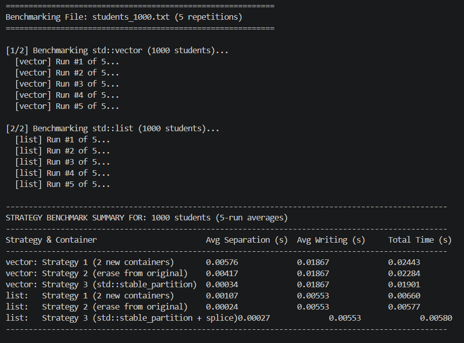
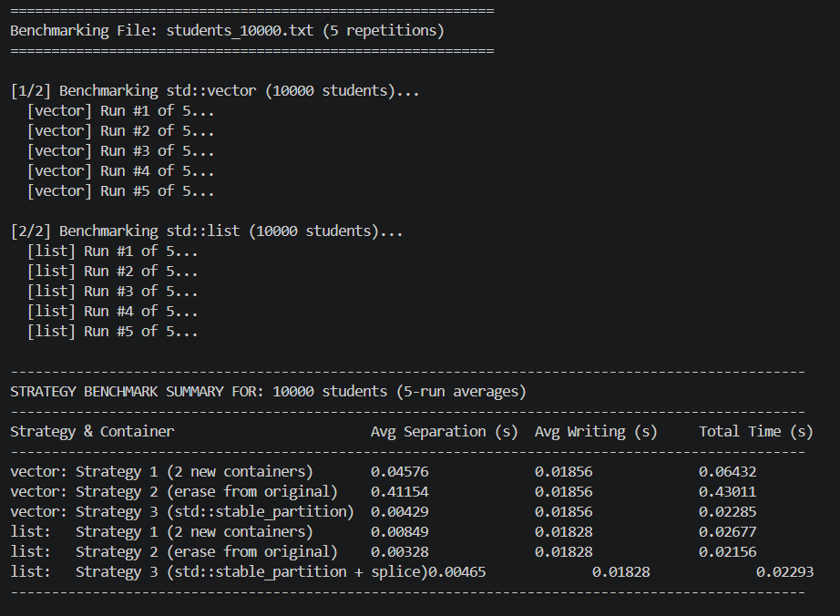

**# Student Grade Management System (v0.3) — Student Separation Optimization**


A C++ Student Grade Management application extending version \`v0.2\` to evaluate, implement, and compare **\*\*three student separation strategies\*\*** across **\*\*\`std::vector\<Student>\`\*\*** and **\*\*\`std::list\<Student>\`\*\*** containers for datasets ranging from 1,000 to 10,000,000 records.


**---**


**## 📁 Project Structure**


\`\`\`

project/

├── Student.h          # Student class declaration (encapsulation, getters/setters)

├── Student.cpp        # Student class method implementations & stream reader

├── Calculation.h           # Declarations for grade calculations & comparison helper

├── Calculation.cpp         # Implementations of calAverage, calMedian, compareByName

├── functions.h        # System declarations (datasets, 3 separation strategies, benchmarks)

├── functions.cpp      # Implementations of 3 strategies, memory address demo, benchmarks

├── main.cpp           # Main interactive menu loop (Options 1–8)

├── Makefile           # Unix Makefile (make, make run, make clean)

├── CMakeLists.txt     # CMake build configuration

├── README.md          # Documentation, empirical benchmarks, and analysis

└── .gitignore         # File exclusion rules for datasets and binaries

\`\`\`


**---**


**## 🎯 1. Assignment Objectives & Classification Rules**


Students are partitioned into two groups based on their calculated final grade:

\- **\*\*Poor (\`belowFive\`)\*\***: Final grade $< 5.0$

\- **\*\*Good (\`fiveOrAbove\`)\*\***: Final grade $\ge 5.0$


**### Final Grade Formulas:**

1\. **\*\*Average Calculation\*\***:

&#x20;  $$\text{Final} = 0.4 \times \text{Homework Average} + 0.6 \times \text{Exam Grade}$$

2\. **\*\*Median Calculation\*\***:

&#x20;  $$\text{Final} = 0.4 \times \text{Homework Median} + 0.6 \times \text{Exam Grade}$$


Both calculation options are supported across all strategies.


**---**


**## ⚙️ 2. The Three Separation Strategies**


**### Strategy 1: Copy into Two New Containers (Baseline)**

\- **\*\*Concept\*\***: The original container remains unchanged. Two new containers (\`belowFive\` and \`fiveOrAbove\`) are created.

\- **\*\*Process\*\***: Iterates through the original container, checks each student's final grade, and copies the student into either \`belowFive\` or \`fiveOrAbove\`.

\- **\*\*Characteristics\*\***: Simple linear time $O(N)$, but requires enough memory to hold the original container plus both output containers simultaneously.

\- **\*\*Functions\*\***: \`separateStudentsStrategy1\` (\`std::vector\`) and \`separateStudentsListStrategy1\` (\`std::list\`).


**### Strategy 2: Move Poor Students into One New Container**

\- **\*\*Concept\*\***: Creates only **\*\*one\*\*** new container (\`belowFive\`). The original container is modified in-place so that it retains only good students ($\ge 5.0$).

\- **\*\*Process\*\***:

&#x20; \- **\*\*\`std::vector\`\*\***: Iterates through the vector. When a student has $\text{final} < 5.0$, the student is moved to \`belowFive\` and erased using \`it = students.erase(it)\`.

&#x20;   \- *\*Performance Bottleneck\**: Because \`std::vector\` stores elements contiguously, erasing an element shifts all subsequent elements left by one position. For $N$ elements, repeated erasures cause $O(N^2)$ memory shifts, resulting in severe slowdown on large datasets.

&#x20; \- **\*\*\`std::list\`\*\***: Iterates through the list. When $\text{final} < 5.0$, the student is moved to \`belowFive\` and erased using \`it = students.erase(it)\`.

&#x20;   \- *\*Efficiency\**: In a doubly-linked list, erasing a node only relinks neighbor pointers ($O(1)$ per erase), resulting in linear $O(N)$ overall time.

\- **\*\*Functions\*\***: \`separateStudentsStrategy2\` (\`std::vector\`) and \`separateStudentsListStrategy2\` (\`std::list\`).


**### Strategy 3: Optimize Separation Using Standard Algorithms**

\- **\*\*Concept\*\***: Eliminates the $O(N^2)$ shifting penalty of Strategy 2 while using only one new container, leveraging standard library algorithms.

\- **\*\*Algorithms Used\*\***:

&#x20; \- **\*\*\`std::stable_partition\` (\`std::vector\`)\*\***: Reorganizes the vector in linear $O(N)$ time so good students ($\ge 5.0$) appear in front and poor students ($< 5.0$) appear at the back, while preserving relative order. The poor students are then moved to \`belowFive\`, and erased from the vector in a single range erase from the end (\`students.erase(bound, students.end())\`) with no element shifting.

&#x20; \- **\*\*\`std::stable_partition\` + \`std::list::splice\` (\`std::list\`)\*\***: Partitions the list elements in $O(N)$ time, then uses \`list::splice\` to transfer the poor students' node sub-chain into \`belowFive\` in $O(1)$ time with **\*\*zero node copies or heap allocations\*\***.

\- **\*\*Functions\*\***: \`separateStudentsStrategy3\` (\`std::vector\`) and \`separateStudentsListStrategy3\` (\`std::list\`).


**## 📊 4. Empirical Performance Benchmark Results**


*\*Methodology: Measured across 5 dataset sizes with 5 repetitions per strategy. Separation time and file-writing time are measured independently using \`std::chrono::high_resolution_clock\`. Output streams are explicitly flushed (\`file.flush()\`) and closed (\`file.close()\`) before stopping timers.\**






**## 🛠️ 6. Build and Execution Instructions**

### Windows (CMake + MinGW/GCC)

Install CMake and a GCC/MinGW toolchain, then open PowerShell in the project directory. Ensure `g++` and `mingw32-make` are available in `PATH`.

```powershell
g++ --version
cmake --version

cmake --build build --config Release 
.\build\Release\student_grade_sys.exe
```

If the `build` directory was previously configured with Visual Studio, delete that generated `build` directory before configuring with MinGW.


### Manual compilation with GCC

```powershell
g++ -O2 -std=c++17 main.cpp Student.cpp functions.cpp median.cpp -o student_grade_sys.exe
.\student_grade_sys.exe
```

**---**


**## 📸 7. Program Menu Options**


\`\`\`

\====================================

&#x20;   STUDENT GRADE SYSTEM (v0.3)    &#x20;

\====================================

1\. Add student manually

2\. Generate random students (in memory)

3\. Display student results

4\. Read student data from file

5\. Generate test dataset files (1K - 10M)

6\. Run benchmarks (Compare 3 strategies)

7\. Memory address demonstration (&student)

8\. Exit

\`\`\`
